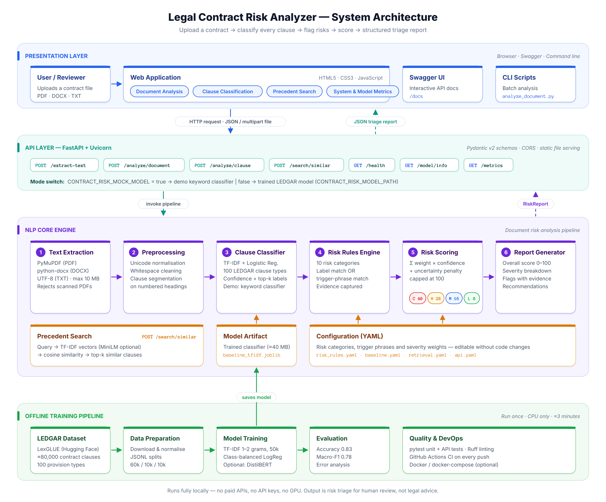

# Legal Contract Risk Analyzer

**NLP-based clause classification and risk triage for legal contracts, with a full web interface.**


Legal Contract Risk Analyzer reads a contract (PDF, DOCX or plain text), splits it into clauses, classifies each clause with a machine-learning model trained on the **LexGLUE LEDGAR** dataset, and applies transparent, configurable risk rules to produce a structured **triage report**: an overall risk score, severity breakdown, per-clause risk flags with evidence, and review recommendations.

The system runs entirely locally. It needs **no paid APIs, no API keys and no GPU**.

> **Disclaimer:** This tool is for document analysis and risk triage only. It is **not legal advice** and does not replace review by a qualified lawyer. All findings require human review.

---

## Table of Contents

- [Key Features](#key-features)
- [How It Works](#how-it-works)
- [Tech Stack](#tech-stack)
- [Project Structure](#project-structure)
- [Getting Started](#getting-started)
- [Using the Web Application](#using-the-web-application)
- [Risk Model and Scoring](#risk-model-and-scoring)
- [Sample Agreements for Testing](#sample-agreements-for-testing)
- [REST API Reference](#rest-api-reference)
- [Model Training and Evaluation](#model-training-and-evaluation)
- [Testing](#testing)
- [Limitations](#limitations)
- [Future Work](#future-work)
- [Acknowledgements](#acknowledgements)

---

## Key Features

| Feature | Description |
| --- | --- |
| **Document upload** | Upload a contract as **PDF, DOCX or TXT** (up to 10 MB). Text is extracted automatically with PyMuPDF / python-docx. |
| **Clause segmentation** | Contracts are cleaned and split into numbered clauses for individual analysis. |
| **Clause classification** | Each clause is assigned a LEDGAR provision type (e.g. *Termination*, *Payments*, *Governing Laws*) with a confidence score and top-k alternatives. |
| **Rule-based risk detection** | 10 risk categories across 4 severity levels, defined in a single, editable YAML file. |
| **Risk scoring (0–100)** | A confidence-weighted overall score with a Critical / High / Medium / Low breakdown. |
| **Triage report** | Risk flags with clause references, reasons and evidence snippets, plus a clause taxonomy breakdown and recommendations. |
| **Single-clause analysis** | Classify and risk-check one clause at a time, with presets for common clause types. |
| **Precedent search** | Find semantically similar clauses using TF-IDF retrieval (optional sentence-transformer embeddings). |
| **Metrics dashboard** | Live API latency, documents and clauses analysed, and baseline model benchmark figures. |
| **Demo (mock) mode** | Runs instantly without a trained model, using a deterministic keyword classifier, which is ideal for demonstrations. |

---

## How It Works

<p align="center">
  
</p>

1. **Extraction:** the uploaded file is converted to plain text (`/extract-text`). Scanned or image-only PDFs are rejected with a clear message.
2. **Segmentation:** text is normalised and split on numbered clause headings (`1.`, `2.`, `3.1` …).
3. **Classification:** each clause is labelled by the trained LEDGAR model (or by the keyword classifier in demo mode).
4. **Risk detection:** a clause is flagged when its **predicted label** matches a risk category, or when its **text** contains one of that category's trigger phrases.
5. **Scoring and reporting:** flags are weighted by severity and model confidence, then assembled into a report with recommendations.

---

## Tech Stack

| Layer | Technology |
| --- | --- |
| Language | Python 3.11+ |
| Machine learning | scikit-learn (TF-IDF vectoriser + Logistic Regression), joblib |
| Optional deep learning | Hugging Face Transformers (DistilBERT), PyTorch, sentence-transformers, FAISS |
| Dataset | LexGLUE **LEDGAR** (≈80,000 labelled contract provisions, 100 classes) |
| Backend | FastAPI, Uvicorn, Pydantic v2 |
| Document parsing | PyMuPDF (PDF), python-docx (DOCX) |
| Frontend | HTML5, CSS3, vanilla JavaScript (served by FastAPI) |
| Configuration | YAML |
| Quality | pytest, Ruff, GitHub Actions CI |
| Deployment (optional) | Docker, docker-compose |

---

## Project Structure

```text
Legal-contract-risk-analyzer/
├── configs/
│   ├── risk_rules.yaml          # Risk categories, trigger phrases, severity weights
│   ├── baseline.yaml            # TF-IDF + Logistic Regression settings
│   ├── transformer.yaml         # Optional DistilBERT fine-tuning settings
│   ├── retrieval.yaml           # Precedent search settings
│   ├── data.yaml                # Dataset sources and output paths
│   └── api.yaml                 # API service settings
├── src/contract_risk_analyzer/
│   ├── api/                     # FastAPI app, routes, schemas, /extract-text upload endpoint
│   ├── web/                     # Web UI: index.html, styles.css, app.js
│   ├── preprocessing/           # Text cleaning and clause segmentation
│   ├── modeling/                # Baseline + transformer training, prediction, model registry
│   ├── risk/                    # Risk rules, scoring and report generation
│   ├── retrieval/               # Clause embedding, indexing and similarity search
│   ├── evaluation/              # Metrics and error analysis
│   ├── data/                    # LEDGAR / CUAD download, preparation and validation
│   └── utils/                   # I/O, logging, reproducibility helpers
├── scripts/                     # CLI entry points (download, train, evaluate, analyze)
├── legal_agreement/             # Sample contracts at different risk levels (for testing)
├── data/samples/                # Small committed samples, including upload test files
├── docs/                        # Model card, dataset notes, benchmarks, API usage
├── notebooks/                   # Dataset exploration
├── tests/                       # Unit and API tests
├── models/                      # Trained model artifacts (generated locally, git-ignored)
├── requirements.txt
├── pyproject.toml
├── Makefile
└── Dockerfile
```

---

## Getting Started

### Prerequisites

- Python **3.11 or newer**
- Git
- About 500 MB of free disk space if you train the model on LEDGAR

Docker is **not** required.

### 1. Clone and install

```bash
git clone https://github.com/vasugoti/Legal-contract-risk-analyzer.git
cd Legal-contract-risk-analyzer

python -m venv .venv
# Windows
.venv\Scripts\activate
# macOS / Linux
source .venv/bin/activate

pip install -e ".[dev]"
```

> **Note on PyTorch (CPU-only):** If you are running on CPU and want a smaller installation footprint, install CPU-only PyTorch:
> ```bash
> pip install torch --index-url https://download.pytorch.org/whl/cpu
> ```

### 2. Run in demo mode (no model needed)

**Windows (PowerShell):**

```powershell
$env:CONTRACT_RISK_MOCK_MODEL="true"
uvicorn contract_risk_analyzer.api.main:app --host 127.0.0.1 --port 8000
```

**macOS / Linux:**

```bash
CONTRACT_RISK_MOCK_MODEL=true uvicorn contract_risk_analyzer.api.main:app --host 127.0.0.1 --port 8000
```

Open **http://127.0.0.1:8000** in your browser. Interactive API documentation is available at **http://127.0.0.1:8000/docs**.

### 3. Run with the trained model (recommended)

Download LEDGAR and train the baseline once (about 3 minutes on a laptop CPU):

```bash
pip install -e ".[data]"
python scripts/download_data.py --dataset ledgar
python scripts/train_baseline.py --config configs/baseline.yaml
```

This creates `models/baseline_tfidf.joblib`. Then start the server in model mode:

**Windows (PowerShell):**

```powershell
$env:CONTRACT_RISK_MOCK_MODEL="false"
$env:CONTRACT_RISK_MODEL_PATH="models/baseline_tfidf.joblib"
uvicorn contract_risk_analyzer.api.main:app --host 127.0.0.1 --port 8000
```

**macOS / Linux:**

```bash
CONTRACT_RISK_MOCK_MODEL=false CONTRACT_RISK_MODEL_PATH=models/baseline_tfidf.joblib \
  uvicorn contract_risk_analyzer.api.main:app --host 127.0.0.1 --port 8000
```

### Environment variables

| Variable | Default | Purpose |
| --- | --- | --- |
| `CONTRACT_RISK_MOCK_MODEL` | `true` | `true` = demo keyword classifier, `false` = trained model |
| `CONTRACT_RISK_MODEL_PATH` | `models/baseline_tfidf.joblib` | Path to the trained classifier |
| `CONTRACT_RISK_RETRIEVAL_INDEX` | `models/retrieval` | Path to a prebuilt search index (optional) |

A template is provided in `.env.example`.

---

## Using the Web Application

The interface has four tabs:

1. **Document Analysis:** upload a PDF/DOCX/TXT contract or paste text, set a document ID, and click **Analyze**. The **Triage Report** shows the overall risk score, number of clauses evaluated, severity breakdown, recommendations, a **Detected Risk Flags** table (flag ID, clause reference, severity, type, reason, evidence) and a **Clause Taxonomy Breakdown**.
2. **Clause Classification:** analyse a single clause. Presets are provided for termination, indemnification, liability, governing law and assignment clauses.
3. **Precedent Search:** search for clauses similar to a query (for example, *"termination without cause"*).
4. **System & Model Metrics:** API health, model mode, runtime latency and baseline benchmark results.

<!-- Add a screenshot of the Triage Report here, for example:
 -->

---

## Risk Model and Scoring

### Risk categories

All rules live in [`configs/risk_rules.yaml`](configs/risk_rules.yaml) and can be changed without touching code.

| Risk category | Severity | Example trigger phrases |
| --- | --- | --- |
| Liability | **Critical** | unlimited liability, consequential damages, liquidated damages |
| Non-compete | **Critical** | non-compete, compete with, competitive business |
| Termination | High | terminate, termination, without cause, immediate effect |
| Indemnification | High | indemnify, hold harmless, defend |
| Exclusivity | High | exclusive, sole provider, not engage |
| Change of control | High | change of control, merger, acquisition |
| Confidentiality | Medium | confidential information, trade secret, non-disclosure |
| Governing law | Medium | governed by, exclusive jurisdiction, venue |
| Assignment | Medium | assign, assignment, without consent |
| Payment | Medium | late payment, interest, invoice, non-refundable |

### Score calculation

Each flag contributes its severity weight multiplied by the model's confidence for that clause:

```text
flag score    = severity_weight × max(confidence, 0.25)
              + 6   (uncertainty penalty, only if confidence < 0.55)

overall score = min(100, Σ flag scores)
```

| Severity | Weight |
| --- | ---: |
| Critical | 40 |
| High | 28 |
| Medium | 16 |
| Low | 8 |

A contract with no flags scores **0**. A few medium-severity flags give a low-to-moderate score, and several high or critical flags quickly reach **100**.

---

## Sample Agreements for Testing

The [`legal_agreement/`](legal_agreement/) folder contains fictional contracts written to exercise the full risk range:

| File | Type | Intended risk level | Demo-mode score |
| --- | --- | --- | ---: |
| `Sample_SaaS_Agreement.pdf` | SaaS subscription | High (all 10 risk categories, 2 critical) | 100 |
| `Sample_SaaS_Agreement_Medium_Risk.pdf` | SaaS subscription | Medium | ≈ 50 |
| `Sample_SaaS_Agreement_Low_Risk.pdf` | SaaS subscription | Low | ≈ 14 |
| `Sample_Rental_Agreement_Low_Risk.pdf` | Residential rental | Low | ≈ 13 |
| `Sample_Rental_Agreement_Zero_Risk.pdf` | Residential rental | Minimal | 0 |
| `Sample_Rental_Agreement_Zero_Risk_v2.pdf` | Residential rental | Minimal (reworded for model mode) | 0 |

Scores in **model mode** can be higher, because the trained classifier may assign risk-related labels (e.g. *Payments*, *Terms*) to clauses that contain no trigger phrases.

`data/samples/test_uploads/` contains files for testing the upload path, including an unsupported image and a scanned/empty PDF that should be rejected.

---

## REST API Reference

| Method | Endpoint | Description |
| --- | --- | --- |
| `GET` | `/health` | Service health check |
| `GET` | `/model/info` | Active model, mock mode and model-loaded status |
| `POST` | `/extract-text` | Upload a PDF/DOCX/TXT file (multipart) and get its text |
| `POST` | `/analyze/document` | Full triage report for a contract |
| `POST` | `/analyze/clause` | Classification and risk flags for a single clause |
| `POST` | `/search/similar` | Top-k similar clauses for a query |
| `GET` | `/metrics` | Runtime counters and average latency |

**Example: analyse a document**

```bash
curl -X POST http://127.0.0.1:8000/analyze/document \
  -H "Content-Type: application/json" \
  -d '{"document_id": "MSA-2026-001", "text": "1. Fees. Customer shall pay all invoices within 30 days. 2. Termination. Either party may terminate without cause."}'
```

**Example: upload a file**

```bash
curl -X POST http://127.0.0.1:8000/extract-text \
  -F "file=@legal_agreement/Sample_SaaS_Agreement.pdf"
```

The document report includes `overall_risk_score`, `severity_breakdown`, `risk_flags`, `predicted_clause_types`, `recommendations` and the legal disclaimer. See [`docs/api_usage.md`](docs/api_usage.md) for more examples.

---

## Model Training and Evaluation

### Dataset

**LexGLUE LEDGAR** is a public corpus of contract provisions taken from SEC filings, each labelled with one of 100 provision types. The dataset is downloaded at setup time and is not committed to the repository.

| Split | Records |
| --- | ---: |
| Train | 60,000 |
| Validation | 10,000 |
| Test | 10,000 |

### Baseline model

TF-IDF (unigrams + bigrams, 50,000 features) with class-balanced Logistic Regression, configured in [`configs/baseline.yaml`](configs/baseline.yaml).

```bash
python scripts/train_baseline.py --config configs/baseline.yaml
python scripts/evaluate_model.py --config configs/baseline.yaml --model models/baseline_tfidf.joblib
```

### Reference results (LEDGAR test set)

| Metric | TF-IDF + LogReg | LegalPro-BERT | Change |
| --- | ---: | ---: | ---: |
| Test Accuracy | 83.07% | **87.05%** | +3.98 pts |
| Test Macro F1 | 0.7826 | **0.8014** | +1.88 pts |
| Test Weighted F1 | 0.8332 | **0.8647** | +3.15 pts |
| Test Micro F1 | 0.8307 | **0.8705** | +3.98 pts |
| Top-3 Accuracy | — | **95.82%** | — |
| *Legal-BERT, LexGLUE paper (published)* | *micro-F1: 0.882* | *macro-F1: 0.830* | *Reference* |

Macro F1 is reported because LEDGAR is highly imbalanced, and accuracy alone hides weak performance on rare clause types. LegalPro-BERT runs at **4.2 ms per clause on GPU (T4)** and **31.45 ms per clause on laptop CPU** (TF-IDF baseline: 1.99 ms). See [`docs/benchmark_report.md`](docs/benchmark_report.md), [`docs/model_card.md`](docs/model_card.md) and [`docs/error_analysis.md`](docs/error_analysis.md) for more detail.

### Optional: transformer model

A DistilBERT fine-tuning pipeline is included for experimentation (GPU recommended):

```bash
pip install -e ".[transformers]"
python scripts/train_transformer.py --config configs/transformer.yaml \
  --max-train-samples 500 --max-eval-samples 200 --epochs 1
```

### Command-line analysis

```bash
python scripts/analyze_document.py \
  --input data/samples/sample_contract.txt \
  --output data/outputs/risk_report.json \
  --model models/baseline_tfidf.joblib     # or --mock
```

---

## Testing

The test suite is deterministic and runs offline without a trained model:

```bash
python -m pytest -q
python -m ruff check src tests scripts
```

GitHub Actions runs compilation, linting and tests on every push (`.github/workflows/ci.yml`).

---

## Limitations

- **Not legal advice.** The output is a triage aid and must be reviewed by a qualified person.
- **Heuristic risk layer.** Rules match labels and phrases, not legal meaning. A fair clause titled *"Termination"* is flagged, while an unfair clause worded without trigger phrases may not be.
- **Label-based flags.** In model mode, any clause classified into a risk-related category is flagged, even if its terms are balanced.
- **English only.** The model is trained on US-style English contracts (SEC filings). Indian and other jurisdictions' contracts are outside its training domain.
- **Digital documents only.** Scanned or image-only PDFs are not supported (no OCR).
- **Segmentation edge cases.** A sentence ending in a number (e.g. *"… October 2027. The parties …"*) can be split into an extra clause.
- **Uncalibrated confidence.** Model confidence scores are not probability-calibrated.

---

## Future Work

- OCR support for scanned contracts (e.g. Tesseract)
- Require both a matching label **and** a trigger phrase before flagging, to reduce false positives
- Context-aware rules that distinguish one-sided from mutual obligations
- Fine-tuned legal language model (e.g. Legal-BERT) for higher accuracy
- Clause-level explanations highlighting the exact trigger words
- Downloadable PDF triage reports
- Indian contract dataset and jurisdiction-specific risk rules

---

## Acknowledgements

- This project builds on [**IlliaSator/contract-risk-analyzer**](https://github.com/IlliaSator/contract-risk-analyzer), which provides the core NLP pipeline, baseline model, risk engine and API. This repository adds a complete web interface, PDF/DOCX/TXT upload and text extraction, and a set of risk-graded sample agreements for testing.
- [LexGLUE](https://github.com/coastalcph/lex-glue) and the **LEDGAR** dataset (Tuggener et al., 2020).
- [FastAPI](https://fastapi.tiangolo.com/), [scikit-learn](https://scikit-learn.org/) and [PyMuPDF](https://pymupdf.readthedocs.io/).

---

<sub>All sample agreements in this repository are fictional and created for software testing only.</sub>
