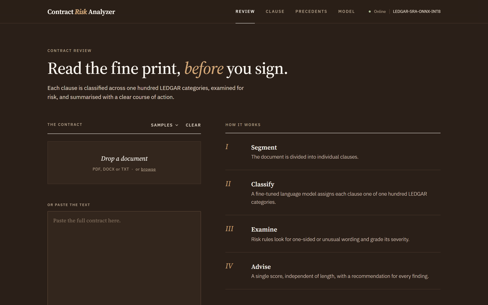
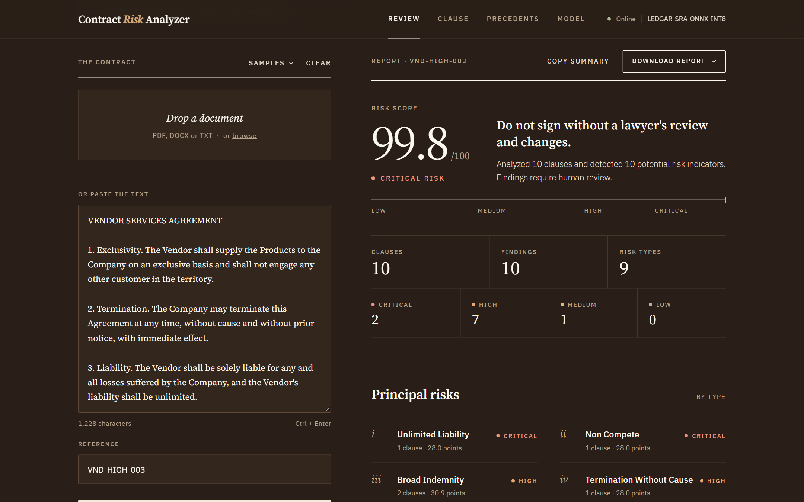
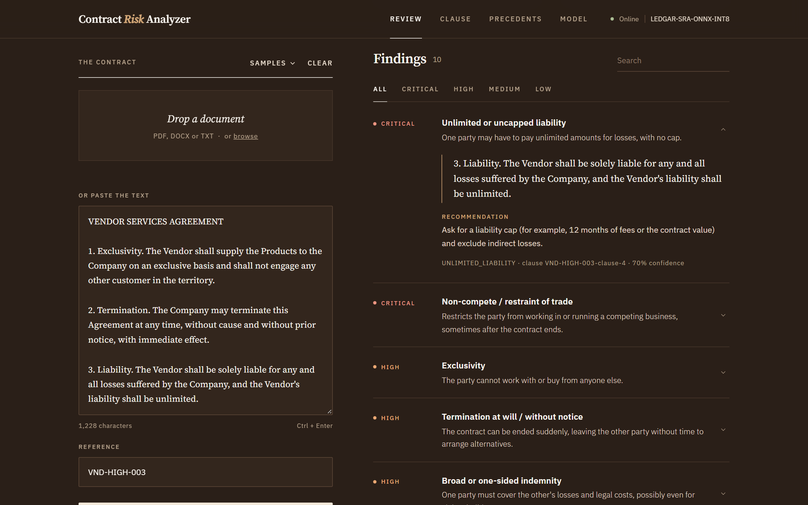
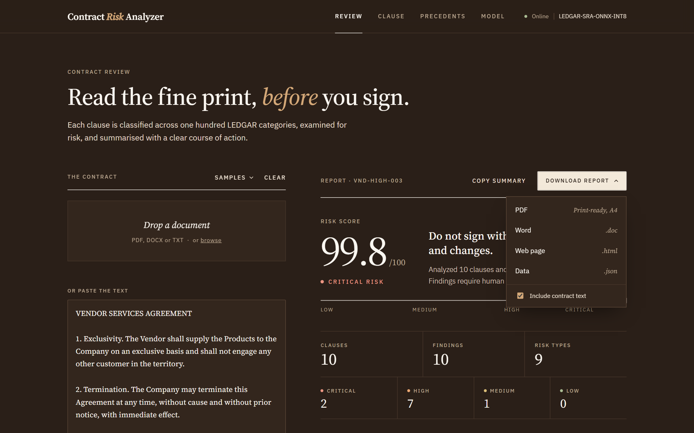
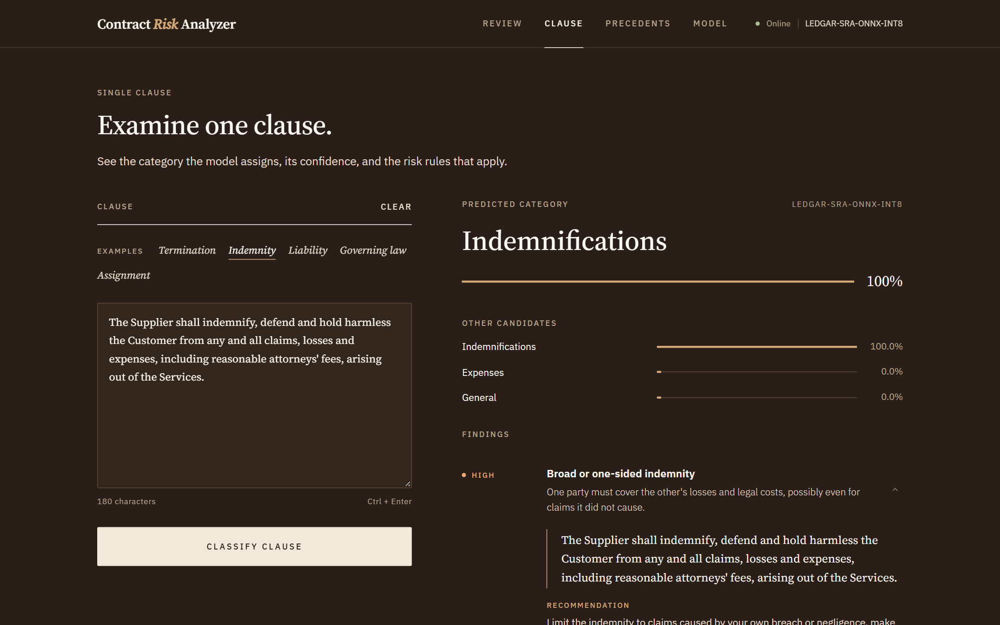
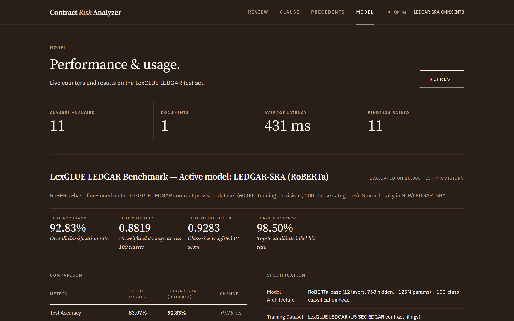
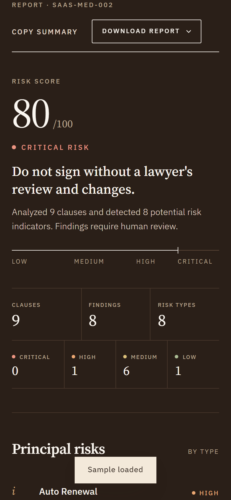

<div align="center">

# Contract Risk Analyzer

**Read the fine print, before you sign.**

An NLP system that reads a contract, classifies every clause into one of 100 LEDGAR categories, flags risky wording, and produces a clear, length-independent risk report — with a recommendation for every finding.

[](https://legal-contract-risk-analyzer.onrender.com/)


-6f42c1)


-46E3B7?logo=render&logoColor=black)

<br/>

<a href="docs/demo/demo.mp4"></a>

<sub>▶ <a href="docs/demo/demo-explainer.mp4"><b>Watch the narrated explainer video (≈2 min, with voice-over)</b></a> &nbsp;·&nbsp; <a href="docs/demo/demo.mp4">Silent walkthrough</a></sub>

</div>

> [!IMPORTANT]
> This tool performs automated **risk triage**. It is **not legal advice** and does not replace review by a qualified lawyer.

---

## Contents

- [What it does](#what-it-does)
- [Screenshots](#screenshots)
- [Features](#features)
- [How it works](#how-it-works)
- [Model and results](#model-and-results)
- [Risk engine and scoring](#risk-engine-and-scoring)
- [Tech stack](#tech-stack)
- [Run it locally](#run-it-locally)
- [Deployment (free)](#deployment-free)
- [REST API](#rest-api)
- [Project structure](#project-structure)
- [Testing](#testing)
- [Limitations and future work](#limitations-and-future-work)
- [Acknowledgements](#acknowledgements)

---

## What it does

1. **Upload** a contract (PDF, DOCX or TXT) or paste its text.
2. The contract is **cleaned and split into clauses**.
3. A **fine-tuned RoBERTa model** (LEDGAR-SRA) assigns every clause one of **100 LEDGAR provision types** — *Indemnifications*, *Terminations*, *Governing Laws* and so on — with a confidence score.
4. A transparent **rule engine** (28 risk types, 4 severity levels) looks for one-sided or unusual wording such as unlimited liability, termination without notice or a post-contract non-compete.
5. You get a **risk score from 0 to 100**, a risk level, every finding with the exact risky phrase highlighted, a recommendation for each one, and a downloadable report.

Try it now: **https://legal-contract-risk-analyzer.onrender.com/** → *Samples* → *Vendor contract* → *Analyse contract*.

> The free hosting plan sleeps after 15 minutes of inactivity. The first visit can take about a minute to wake up, and the first analysis 20–60 seconds.

---

## Screenshots

<table>
  <tr>
    <td width="50%"><br/><sub><b>Home</b> — upload a document or paste text; try built-in samples.</sub></td>
    <td width="50%"><br/><sub><b>Risk report</b> — score, level, course of action and severity counts.</sub></td>
  </tr>
  <tr>
    <td><br/><sub><b>Findings</b> — the risky phrase is highlighted, with a recommendation.</sub></td>
    <td><br/><sub><b>Download</b> — full report as PDF, Word, HTML or JSON.</sub></td>
  </tr>
  <tr>
    <td><br/><sub><b>Single clause</b> — category, confidence, top candidates and rules fired.</sub></td>
    <td><br/><sub><b>Model</b> — live usage counters and benchmark results.</sub></td>
  </tr>
</table>

<p align="center"><br/><sub><b>Mobile</b> — fully responsive.</sub></p>

---

## Features

| | |
| --- | --- |
| **Document input** | PDF, DOCX and TXT upload (drag and drop) or pasted text. Text extraction with PyMuPDF and python-docx. |
| **Clause classification** | 100 LEDGAR categories with confidence and top-k alternatives, using an INT8 ONNX export of the fine-tuned RoBERTa model. |
| **Risk detection** | 28 risk types across low, medium, high and critical severity, defined in one editable YAML file. Whole-word matching, exclusion phrases and confidence thresholds keep false alarms down. |
| **Length-independent score** | A long contract is not scored higher just because it has more clauses (see [scoring](#risk-engine-and-scoring)). |
| **Explainable findings** | Every finding shows the clause, the highlighted trigger phrase, why it matters and a concrete recommendation. |
| **Indian-law aware** | Rules cover lock-in periods, security deposits, rent escalation, Section 27 non-competes, unilateral arbitrator appointment and the DPDP Act 2023. |
| **Report export** | Print-ready A4 PDF, Word (.doc), standalone HTML and raw JSON, optionally with the full contract text as an appendix. |
| **Single-clause mode** | Classify and risk-check one clause, with example presets. |
| **Lightweight deployment** | Runs in about 355 MB of RAM with no PyTorch, so it fits the Render free plan. |

---

## How it works

<p align="center">
  
</p>

```text
Contract (PDF / DOCX / TXT)
   │  extract text            PyMuPDF · python-docx
   ▼
Clean & segment             → clauses
   │
   ▼
Classify each clause        LEDGAR-SRA RoBERTa (ONNX INT8) → label + confidence
   │
   ▼
Risk rules                  configs/risk_rules.yaml → findings (severity, reason, fix)
   │
   ▼
Score & report              length-independent score, level, recommendations, export
```

---

## Model and results

All numbers are on the **LexGLUE LEDGAR** test split (100 classes).

| Model | Evaluation | Accuracy | Macro-F1 | Notes |
| --- | --- | ---: | ---: | --- |
| TF-IDF + Logistic Regression | full test set (10,000) | **83.07%** | **78.26%** | ~2 ms per clause on CPU |
| LEDGAR-SRA (RoBERTa-base) | raw clauses, random 1,000 (seed 42) | 65.50% | 38.81% | how the live app uses the model |
| LEDGAR-SRA, ONNX INT8 | raw clauses, 300 | 70.67% | — | 97.33% top-1 agreement with the PyTorch model |

**About the notebook's 92.83%.** The training notebook (`NLP/Untitled0.ipynb`) uses *Semantic Retrieval Augmentation* (SRA): for low-frequency classes, each input is paired with a related clause. During the notebook's test evaluation, that related clause was chosen **using the true test label**, which leaks the answer. The 92.83% accuracy / 88.19% macro-F1 reported there is therefore **not comparable** to the results above and is not claimed here. Re-training with label-free retrieval is listed under [future work](#limitations-and-future-work).

**Deployment model.** The RoBERTa model was exported to ONNX and dynamically quantized to INT8 (per-channel): **121 MB** instead of ~500 MB, **~355 MB peak RAM**, **~1.9 s per contract** on a laptop CPU, with no PyTorch at runtime.

---

## Risk engine and scoring

Rules live in [`configs/risk_rules.yaml`](configs/risk_rules.yaml). Each rule has a severity, trigger phrases and regexes, exclusion phrases, optional LEDGAR labels, a reason and a recommendation.

- A rule fires on **risky wording**, not on a normal clause type. A plain *Governing Laws* clause is not a risk; "exclusive jurisdiction of foreign courts" is.
- The model's label raises confidence when it agrees with the wording. For risky-by-nature clause types (indemnity, change of control, waivers), the label alone can raise a flag, but only above a confidence threshold.
- At most one finding per clause per risk type.

**Overall score (0–100), independent of contract length:**

1. Each risk **type** counts once, with weight `low 8 · medium 16 · high 28 · critical 40` × best confidence.
2. Repeats add a small, capped bonus: `1 + min(0.15 · ln(n), 0.30)`.
3. A saturating curve: `score = 100 · (1 − e^(−raw / 90))`, so piling up flags never reaches 100.
4. The share of risky clauses adjusts the score by at most ±10%.
5. Floor and ceiling by the worst severity: only low risks → at most 25; any critical risk → at least 40.

| Level | Score | Suggested action |
| --- | --- | --- |
| Low | 0–30 | Standard review is enough. |
| Medium | 30–60 | Negotiate the flagged clauses before signing. |
| High | 60–80 | Get legal review before signing. |
| Critical | 80–100 | Do not sign without a lawyer's review and changes. |

Every value above is configurable in the YAML file without code changes.

---

## Tech stack

| Layer | Technology |
| --- | --- |
| Model | RoBERTa-base fine-tuned on LEDGAR (Hugging Face Transformers, PyTorch — training only) |
| Inference | ONNX Runtime (INT8), Hugging Face `tokenizers` |
| Baseline | scikit-learn TF-IDF + Logistic Regression |
| Backend | FastAPI, Pydantic, Uvicorn |
| Documents | PyMuPDF, python-docx |
| Frontend | HTML, CSS and vanilla JavaScript (no framework) |
| Hosting | Render (app), Hugging Face Hub (model files) |

---

## Run it locally

Requires **Python 3.11+** and Git.

```bash
git clone https://github.com/vasugoti/Legal-contract-risk-analyzer.git
cd Legal-contract-risk-analyzer
python -m venv .venv
```

Activate it: `.venv\Scripts\activate` (Windows) or `source .venv/bin/activate` (macOS / Linux).

### Option A — lightweight ONNX model (same as the live site)

```bash
pip install -r requirements-render.txt
pip install -e . --no-deps
```

**Windows (PowerShell)**

```powershell
$env:MODEL_BASE_URL="https://huggingface.co/vasugoti07/ledgar-sra-onnx/resolve/main"
python scripts/download_model.py
$env:CONTRACT_RISK_BACKEND="onnx"
$env:CONTRACT_RISK_MOCK_MODEL="false"
uvicorn contract_risk_analyzer.api.main:app --host 127.0.0.1 --port 8000
```

**macOS / Linux**

```bash
export MODEL_BASE_URL=https://huggingface.co/vasugoti07/ledgar-sra-onnx/resolve/main
python scripts/download_model.py
CONTRACT_RISK_BACKEND=onnx CONTRACT_RISK_MOCK_MODEL=false \
  uvicorn contract_risk_analyzer.api.main:app --host 127.0.0.1 --port 8000
```

Open **http://127.0.0.1:8000** — API docs at **/docs**.

### Option B — demo mode (no model download)

```bash
pip install -e .
CONTRACT_RISK_MOCK_MODEL=true uvicorn contract_risk_analyzer.api.main:app --port 8000
```

(On Windows PowerShell: `$env:CONTRACT_RISK_MOCK_MODEL="true"` first.)

### Option C — train the TF-IDF baseline yourself

```bash
pip install -e ".[data]"
python scripts/download_data.py --dataset ledgar
python scripts/train_baseline.py --config configs/baseline.yaml
```

### Environment variables

| Variable | Purpose | Example |
| --- | --- | --- |
| `CONTRACT_RISK_BACKEND` | Classifier backend | `onnx` |
| `CONTRACT_RISK_MOCK_MODEL` | Keyword-based demo classifier, no model needed | `true` / `false` |
| `MODEL_BASE_URL` | Where `scripts/download_model.py` fetches the ONNX files | Hugging Face `resolve/main` URL |
| `CONTRACT_RISK_ONNX_DIR` | Folder with the ONNX model | `NLP/LEDGAR_SRA_ONNX` |
| `CONTRACT_RISK_MODEL_CONFIG` | Config for the PyTorch backend | `configs/ledgar_sra.yaml` |
| `CONTRACT_RISK_MODEL_PATH` | Path to the TF-IDF baseline | `models/baseline_tfidf.joblib` |

---

## Deployment (free)

The live site runs on **Render's free plan** (512 MB RAM). The 121 MB ONNX model is hosted on **Hugging Face Hub** and downloaded during the build.

| Render setting | Value |
| --- | --- |
| Language | Python 3 |
| Build command | `pip install -r requirements-render.txt && pip install -e . --no-deps && python scripts/download_model.py` |
| Start command | `uvicorn contract_risk_analyzer.api.main:app --host 0.0.0.0 --port $PORT` |
| Environment | `CONTRACT_RISK_BACKEND=onnx`, `CONTRACT_RISK_MOCK_MODEL=false`, `PYTHON_VERSION=3.11.9`, `MODEL_BASE_URL=https://huggingface.co/vasugoti07/ledgar-sra-onnx/resolve/main` |
| Health check | `/health` |

To re-create the ONNX model from the PyTorch weights: `python scripts/export_onnx.py`, then check it with `python scripts/check_onnx_accuracy.py`.

---

## REST API

Interactive documentation: [`/docs`](https://legal-contract-risk-analyzer.onrender.com/docs).

| Method | Endpoint | Description |
| --- | --- | --- |
| `GET` | `/health` | Service status |
| `GET` | `/model/info` | Active model, backend and label count |
| `POST` | `/extract-text` | Upload a PDF / DOCX / TXT file (`multipart/form-data`, field `file`) and get its text |
| `POST` | `/analyze/clause` | Classify and risk-check one clause |
| `POST` | `/analyze/document` | Full contract analysis and risk report |
| `POST` | `/search/similar` | Similar precedent clauses (empty on the free deployment) |
| `GET` | `/metrics` | Usage counters and benchmark data |

```bash
curl -X POST https://legal-contract-risk-analyzer.onrender.com/analyze/clause \
  -H "Content-Type: application/json" \
  -d '{"text": "The Vendor shall indemnify, defend and hold harmless the Company from any and all claims."}'
```

```bash
curl -X POST https://legal-contract-risk-analyzer.onrender.com/analyze/document \
  -H "Content-Type: application/json" \
  -d '{"document_id": "demo-001", "text": "1. Termination. The Company may terminate this Agreement at any time without cause. 2. Liability. The Vendor liability shall be unlimited."}'
```

---

## Project structure

```text
Legal-contract-risk-analyzer/
├── src/contract_risk_analyzer/
│   ├── api/            FastAPI app, routes, request/response schemas
│   ├── modeling/       ONNX classifier, RoBERTa / TF-IDF backends, registry
│   ├── risk/           rule engine, scoring, report builder
│   ├── data/           cleaning and clause segmentation
│   └── web/            frontend (index.html, styles.css, app.js)
├── configs/            risk_rules.yaml, model and API configs
├── NLP/                training notebook, LEDGAR-SRA model, ONNX export
├── scripts/            training, evaluation, ONNX export, deployment helpers
├── legal_agreement/    sample contracts for testing
├── reports/            evaluation metrics
├── docs/               model card, benchmark report, images, demo video
└── tests/              pytest suite
```

---

## Testing

```bash
pip install -e ".[dev]"
python -m pytest -q
python -m ruff check src tests scripts
```

Sample contracts in [`legal_agreement/`](legal_agreement) cover zero, low and medium risk rental and SaaS agreements.

To refresh the screenshots and silent demo in this README from the live site:

```bash
pip install playwright imageio-ffmpeg edge-tts
python -m playwright install chromium
python scripts/capture_readme_media.py
```

To make the narrated explainer video (neural voice-over, title cards, zoom, subtitles), start the app locally and run:

```bash
python scripts/make_demo_video.py                              # US English voice
python scripts/make_demo_video.py --voice en-IN-PrabhatNeural  # Indian English voice
```

---

## Limitations and future work

**Limitations**

- On raw clauses the deployed RoBERTa model (65.5%) is less accurate than the TF-IDF baseline (83.07%), because it was trained with retrieval-augmented inputs that are not available at inference time.
- Risk rules are phrase-based. They can miss unusual wording and cannot judge commercial context or which party you are.
- Scanned PDFs need OCR first; only English contracts are supported.
- On the free plan the app sleeps when idle and analysis is slower (0.1 CPU).

**Future work**

- Re-train LEDGAR-SRA with **label-free retrieval** (nearest training clause by embedding similarity) and evaluate on raw clauses.
- Combine the TF-IDF and transformer predictions in an ensemble.
- Party-aware risk ("which side am I on?").
- OCR support for scanned documents and multilingual contracts.

---

## Acknowledgements

- **LexGLUE / LEDGAR** — Chalkidis et al., *LexGLUE: A Benchmark Dataset for Legal Language Understanding in English* (ACL 2022); Tuggener et al., *LEDGAR* (LREC 2020).
- **RoBERTa** — Liu et al., 2019, via Hugging Face Transformers.
- **ONNX Runtime**, **FastAPI**, **scikit-learn**, **PyMuPDF**.

<div align="center">
<sub>Built as a final-year B.Tech NLP project · <a href="https://legal-contract-risk-analyzer.onrender.com/">Live demo</a> · Not legal advice</sub>
</div>
